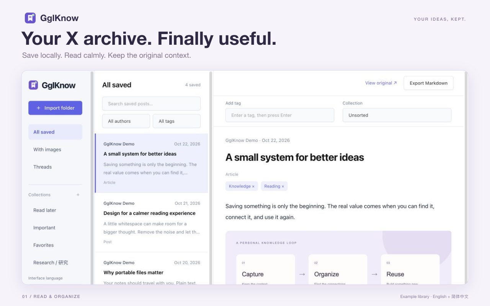

<div align="center">
  
  <h1>GglKnow</h1>
  <p><strong>Keep what matters. Make it your knowledge.</strong></p>
  <p>Save X posts and articles to your computer.<br>Read, organize, and bring them into Obsidian.</p>
  <p><b>English</b> · <a href="README.zh-CN.md">简体中文</a></p>
  <p><a href="https://chromewebstore.google.com/detail/njdfieabmofhifpgficmgmjaggffkhdk">Chrome Web Store</a> · <a href="https://github.com/aixiaojiao/gglknow/issues">Report an issue</a> · <a href="PRIVACY_POLICY.md">Privacy</a></p>
</div>



A useful post should be more than a bookmark you never open again. GglKnow saves the content already loaded on X as portable files you control, with a local library for reading and organizing them later.

## What you can do

| Save | Read | Take it with you |
| --- | --- | --- |
| Export posts, articles, and loaded threads as **HTML, JSON, and Markdown**. | Search your library and filter by author, tags, collections, images, or threads. | Use **Obsidian Properties** and relative media paths, without a proprietary storage format. |
| Preserve paragraphs, lists, tables, and inline image order. | Add your own tags and collections. Import legacy saves and metadata backups. | Keep the Markdown file and its `media` folder together when moving them into your vault. |

**English and Simplified Chinese:** the popup and X capture controls follow Chrome’s interface language. The reader and guide also have a language selector. Switching language changes the interface, not the original content or your custom tags and collection names.

## Get started

1. [Install from the Chrome Web Store](https://chromewebstore.google.com/detail/njdfieabmofhifpgficmgmjaggffkhdk). The store may serve an earlier approved version while a new release is under review.
2. Open the extension popup. Enter a download subfolder such as `GglKnow`, select your export formats, and save the settings.
3. On X, manually expand a post or open an article. Wait for the content to load, then click **Collect**.
4. Open **Library** from the popup. Import the complete saved folder, including `media`, to read and organize it.

The download path is relative to Chrome’s default download directory. For example, `GglKnow` creates a folder inside Downloads. Absolute paths are not supported. Folder access in the reader is temporary: select it again after reopening or refreshing the page. Your tags and collections remain in the browser.

## Obsidian, without the copy-and-paste

```text
Your vault/
└── Saved article/
    ├── article.md
    └── media/
        ├── image_1.jpg
        └── image_2.png
```

Markdown exports include `title`, `type`, `source`, `author`, `author_handle`, `url`, `created`, `captured`, `published`, `tags`, and `capture_scope`. Field names stay stable across languages. Add tags in the reader and export Markdown again when you want an updated copy.

## What gets saved

GglKnow saves **only content currently loaded on the page**. It does not automatically scroll, expand posts, paginate, or call private X APIs. A saved thread may be incomplete; collapsed, unloaded, or virtualized-away content is excluded.

- One save task at a time, with a shared **five-second interval** across tabs.
- Up to **25 loaded posts** and **50 images** per save; two concurrent image downloads.
- If some images fail, the extension reports partial success and keeps the saved text.
- No video downloads, AI tagging, paid subscriptions, or developer cloud storage in this release.

Follow X’s rules and respect content owners’ rights. These limits do not guarantee protection from platform restrictions.

## Your files stay yours

Saved content and reader metadata are processed locally and are not uploaded to the developer. Extension settings use `chrome.storage.sync`, so Chrome may sync them if browser sync is enabled. Tags and collections use local browser storage; cooldown state uses session storage. Image downloads contact X’s image servers. There are no analytics trackers. See the [privacy policy](PRIVACY_POLICY.md).

## Run from source

Requires Node.js 18+ and a Chromium browser with Manifest V3 support.

```sh
npm ci
npm run build
```

Open `chrome://extensions`, enable Developer mode, choose **Load unpacked**, and select `dist/`. Refresh any open X tabs after updating the extension.

| Command | Purpose |
| --- | --- |
| `npm run build` | Type-check and build all extension surfaces and bundled dependencies. |
| `npm run lint` | Check TypeScript sources. |
| `npm run zip` | Package the existing `dist/` as a store upload ZIP. Run after building. |

The root `manifest.json` is the build entry. Releases go through a PR and Chrome Web Store review. Store image sources and exported assets are in [`assets/store`](assets/store); the guide is bundled in the extension.

## Feedback and credits

Include your browser version, the affected X URL if it is safe to share, expected versus actual behavior, and whether the problem concerns capture, export, or the reader. Never include private browsing data or access credentials in an issue.

Built with TypeScript, Vite, Rollup, [Tabler](https://github.com/tabler/tabler), [DOMPurify](https://github.com/cure53/DOMPurify), and [Turndown](https://github.com/mixmark-io/turndown). Dependency licenses ship with the extension.

[MIT License](LICENSE)
