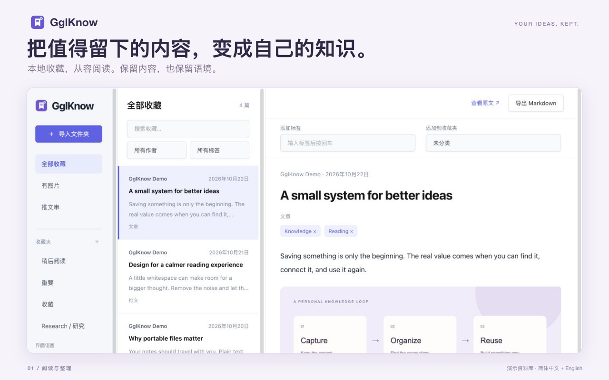

<div align="center">
  
  <h1>GglKnow</h1>
  <p><strong>把值得留下的内容，变成自己的知识。</strong></p>
  <p>将 X 推文与文章保存到本地，<br>在阅读器中整理，带入 Obsidian 长期使用。</p>
  <p><a href="README.md">English</a> · <b>简体中文</b></p>
  <p><a href="https://chromewebstore.google.com/detail/njdfieabmofhifpgficmgmjaggffkhdk">Chrome 应用商店</a> · <a href="https://github.com/aixiaojiao/gglknow/issues">问题反馈</a> · <a href="PRIVACY_POLICY.md">隐私政策</a></p>
</div>



收藏不该只是多一个永远不会点开的书签。GglKnow 将 X 页面已加载的内容保存为你能掌控的文件，再用本地资料库阅读、搜索和整理。

## 能做什么

| 保存内容 | 阅读整理 | 带入知识库 |
| --- | --- | --- |
| 普通推文、长文章和已加载推文串，导出 **HTML、JSON、Markdown**。 | 搜索正文、作者和标签；按作者、标签、收藏夹、图片或推文串筛选。 | Markdown 自带 **Obsidian Properties**，图片使用相对路径。 |
| 保留段落、列表、表格和文中图片顺序。 | 手动添加标签、创建收藏夹，兼容旧收藏文件和标签备份。 | 文件格式开放，把 Markdown 和 `media` 一起搬进你的仓库即可。 |

**支持简体中文与英文。** 设置弹窗和 X 收藏按钮跟随 Chrome 界面语言；阅读器和使用指南另有语言切换。切换时只改变界面，不翻译原文、不改动你的标签和自定义收藏夹名称。

## 四步开始

1. 从 [Chrome 应用商店安装](https://chromewebstore.google.com/detail/njdfieabmofhifpgficmgmjaggffkhdk)。新版本审核期间，商店仍可能提供之前已通过审核的版本。
2. 点击插件图标，输入下载子目录（例如 `GglKnow`），选择导出格式并保存设置。
3. 在 X 手动展开正文或打开文章，等待内容加载后点击 **收藏**。
4. 从弹窗打开 **收藏资料库**，导入包含 `media` 子目录的完整收藏文件夹。

下载路径相对于 Chrome 默认下载目录。填写 `GglKnow`，就会在下载目录中创建该文件夹；不支持绝对路径，也不必重复写 `Downloads`。阅读器的文件访问授权是临时的，关闭或刷新后需重新选择目录；标签和收藏夹仍保留在浏览器中。

## 直接带入 Obsidian

```text
你的知识库/
└── 一篇收藏文章/
    ├── article.md
    └── media/
        ├── image_1.jpg
        └── image_2.png
```

Markdown 包含 `title`、`type`、`source`、`author`、`author_handle`、`url`、`created`、`captured`、`published`、`tags` 和 `capture_scope`。字段名不随界面语言改变。你可以在阅读器里补充标签，再次导出 Markdown。

## 收藏范围与限制

**只保存当前页面已经加载的内容。** 不自动滚动、展开、翻页，也不调用 X 私有接口。未加载、折叠或被虚拟滚动移除的内容不会保存；推文串不保证完整。

- 一次一个任务，所有标签页共享 **5 秒收藏间隔**。
- 单次最多 **25 条已加载推文、50 张图片**，图片下载并发为 2。
- 部分图片下载失败时保留正文，并提示部分成功。
- 本版不包含视频下载、AI 自动标签、付费订阅或开发者云存储。

请遵守 X 的规则与内容作者的权利。上述限制不能保证账号不会受到平台限制。

## 文件属于你

收藏内容与阅读器标签在本地处理，不会上传给开发者。扩展设置使用 `chrome.storage.sync`，启用 Chrome 同步后可能跨设备同步；标签和收藏夹使用本地浏览器存储，收藏间隔使用会话存储。下载图片会请求 X 图片服务器。没有分析埋点。详见 [隐私政策](PRIVACY_POLICY.md)。

## 从源码运行

需要 Node.js 18+，以及支持 Manifest V3 的 Chromium 浏览器。

```sh
npm ci
npm run build
```

打开 `chrome://extensions`，启用开发者模式，点击 **加载已解压的扩展程序**，选择 `dist/`。更新插件后，请刷新已打开的 X 页面。

| 命令 | 用途 |
| --- | --- |
| `npm run build` | 类型检查，构建全部界面与本地依赖。 |
| `npm run lint` | 检查 TypeScript 代码。 |
| `npm run zip` | 将现有 `dist/` 打成商店上传包，需先构建。 |

根目录 `manifest.json` 是构建入口。生产更新必须经过 PR 和商店审核。商店图片的源文件和成品位于 [`assets/store`](assets/store)，使用指南随插件提供。

## 反馈与致谢

提交问题时请注明浏览器版本、可安全公开的 X 链接、预期与实际结果，以及问题出在收藏、导出还是阅读器。不要上传私人浏览数据或访问凭证。

使用 TypeScript、Vite、Rollup、[Tabler](https://github.com/tabler/tabler)、[DOMPurify](https://github.com/cure53/DOMPurify) 和 [Turndown](https://github.com/mixmark-io/turndown) 构建。依赖许可证随插件打包。

[MIT 开源许可证](LICENSE)
